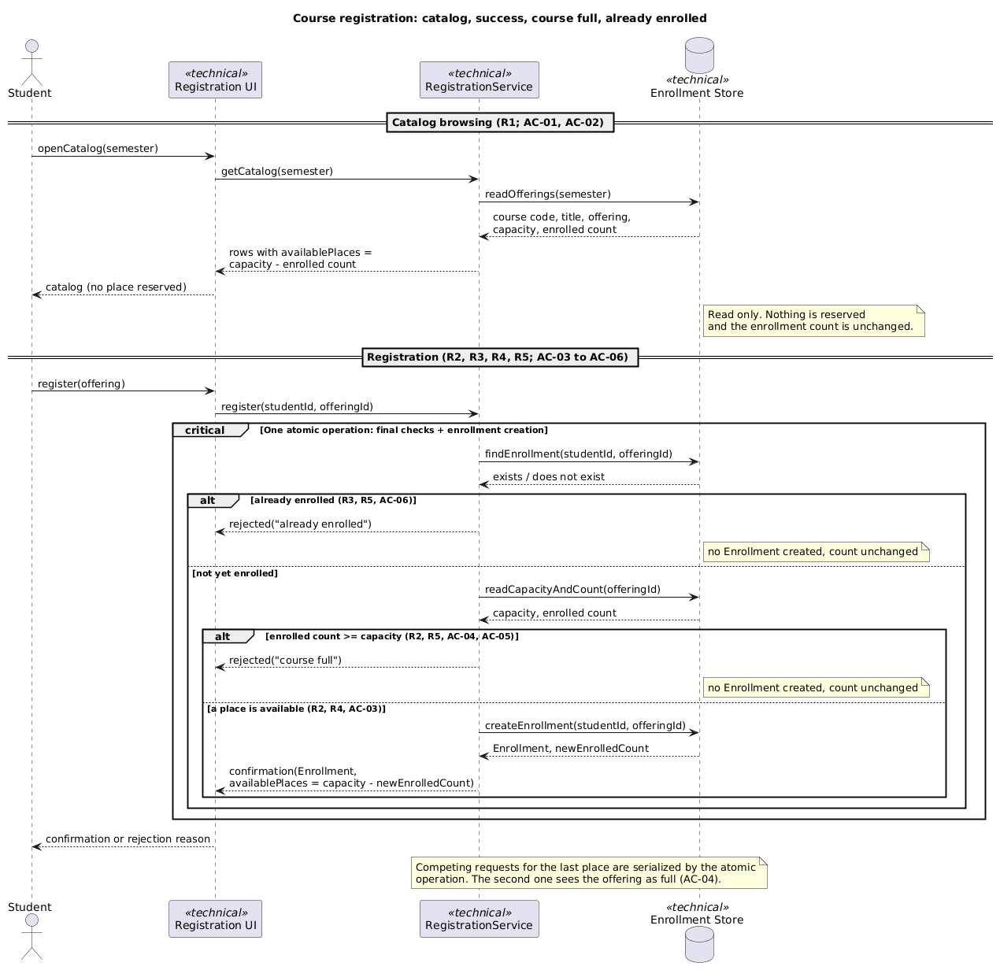
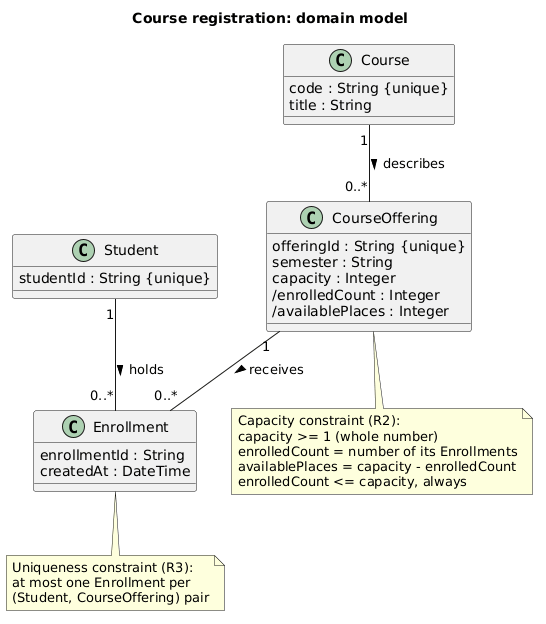
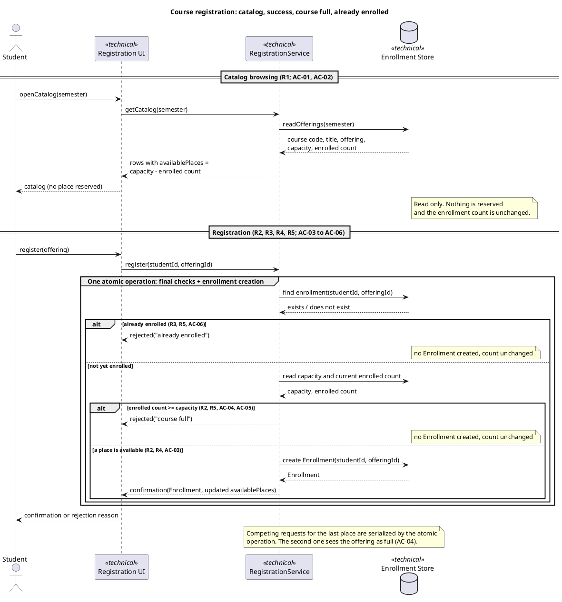
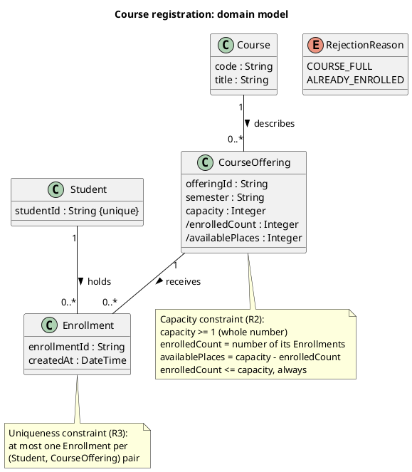
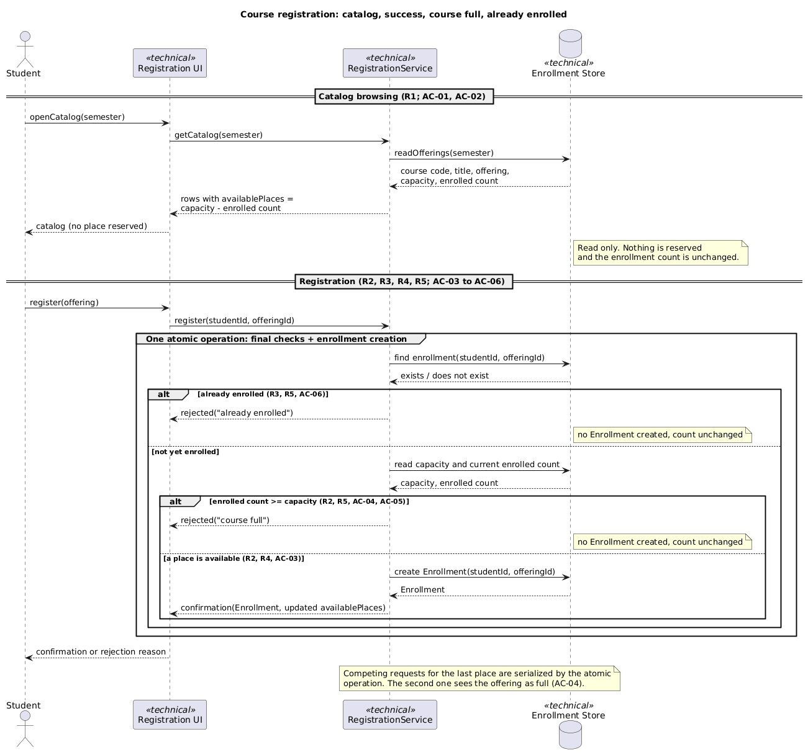
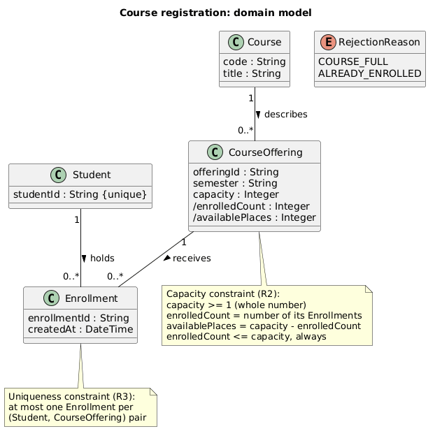

# SIS #02 — AI-Assisted UML Modeling: University Course Registration

<!--
  This is the only file you write your report in. README.md tells you what goes where.

  Rules the checker relies on:
  - Do not delete, rename or renumber the ## headings, the ### headings, or the **Label:** words.
  - Replace every "(write here)" and "(paste here)". None may be left when you submit.
  - Comments like this one are ignored by the checker and the word counter. Delete them or leave them.
-->

## 1. Scope and assumptions

**Scope:** This model covers single-semester university course catalog browsing and atomic student registration into a specific course offering with live capacity and duplicate-enrollment checks (R1–R5), while explicitly excluding payments, prerequisites, timetable clashes, waiting lists, and cancellation.

**Assumptions:**

1. Every student using the system is already signed in and identified by a unique student account before browsing or registering.
2. Each course offering represents a specific scheduled section of a course in a single semester with a fixed positive integer capacity, and viewing the catalog does not lock or reserve a seat.
3. Duplicate enrollment checks, current capacity checks, and enrollment creation happen together as a single atomic operation during registration so competing requests cannot take the same last place.
4. When a repeat request occurs on an offering that is also full, checking duplicate status (`R3`) before capacity (`R2`) provides deterministic rejection feedback.

## 2. User stories and acceptance criteria

### US-01 — Browse offerings

**US-01:** As a signed-in student, I want to view the catalog of offerings for one semester showing course code, title, offering and available places, so that I can choose an offering to register for.

- **AC-01** (R1): Given a semester that has offerings, each with a capacity and some existing enrollments, When the student opens the catalog for that semester, Then each offering is listed with its course code, course title, offering identifier and available places (capacity minus current enrollments), and no place is reserved for the student by viewing.
- **AC-02** (R1, R2): Given an offering whose enrollments equal its capacity, When the student views the catalog for that semester, Then the offering is still listed with 0 available places and the enrollment count is unchanged by the view.

### US-02 — Register for an offering

**US-02:** As a signed-in student, I want to register for a specific offering and receive a confirmation, so that I know I hold a place in it.

- **AC-03** (R2, R3, R4): Given an offering with at least one available place and a student with no enrollment in it, When the student requests registration for that offering, Then the system rechecks availability and duplicates, creates exactly one Enrollment linking the student and the offering, reduces available places by one, and returns a confirmation.
- **AC-04** (R2, R4, R5): Given an offering with exactly one available place and two different students who each have no enrollment in it, When both submit registration requests at the same time, having both seen the place as available in the catalog, Then exactly one request succeeds with a confirmation and one Enrollment, the other is rejected as "course full", and enrollments never exceed capacity.

### US-03 — Receive a clear rejection

**US-03:** As a signed-in student, I want a clear reason when my registration is refused, so that I know whether the offering is full or I am already enrolled in it.

- **AC-05** (R2, R5): Given an offering with no available places and a student with no enrollment in it, When the student requests registration, Then the system rejects the request with the explanation "course full", creates no Enrollment, and leaves the enrollment count unchanged.
- **AC-06** (R3, R5): Given a student who already has an enrollment in the offering, When the student requests registration for the same offering again, Then the system rejects the request with the explanation "already enrolled", creates no additional Enrollment, and leaves the enrollment count unchanged.

## 3. Sequence diagram

<!-- The FINAL diagram, rendered. Change .png to .svg if that is what you exported. -->



**Participants:** (write here — each lifeline and what it stands for)

**Atomic operation:** (write here — which messages form the one atomic step: the final duplicate check, the capacity check and the creation of the Enrollment, and why a catalog view reserves nothing)

**Where the Enrollment is created:** (write here — which message, which lifeline, and which class in section 4 it produces)

**Technical lifelines:** (write here — every lifeline that is NOT a class in the class diagram, by name, and why the difference in abstraction is fine. "None" if there are none.)

## 4. Class diagram

<!-- The FINAL diagram, rendered. -->



<!-- One row per association in classes.puml, read in both directions. -->

| Association | Read left to right | Read right to left |
| --- | --- | --- |
| (write here) | (write here) | (write here) |
| (write here) | (write here) | (write here) |
| (write here) | (write here) | (write here) |

**How an Enrollment links a student to an offering:** (write here)

**Capacity constraint:** (write here — and why multiplicity alone cannot express it)

**Uniqueness constraint:** (write here — and why multiplicity alone cannot express it)

## 5. Traceability

<!-- Every rule, including the catalog fields and availability (R1). Column 1: the rule and
     the criteria that cover it, e.g. "R2 + AC-03, AC-04". Column 2: the message, guard,
     class or constraint that shows the rule in YOUR diagrams. Column 3: the T-ID that
     exercises it, or the extra check you did instead (R1 has no T case). -->

| Rule and criterion | Model evidence | Validation case |
| --- | --- | --- |
| R1 + (write here) | (write here) | (write here) |
| R2 + (write here) | (write here) | (write here) |
| R3 + (write here) | (write here) | (write here) |
| R4 + (write here) | (write here) | (write here) |
| R5 + (write here) | (write here) | (write here) |

## 6. Walkthroughs

<!-- Walk each case through YOUR final sequence diagram, message by message. Column 2: the
     actual steps and the state change (count before → after). Column 3 starts with Pass or
     Fail, then the location: the message, guard or note where you saw it. A Fail you
     report honestly is a finding, not a penalty. -->

| Case | Observed path and state change | Judgment and evidence |
| --- | --- | --- |
| T1. Available | (write here) | (write here) |
| T2. Last place | (write here) | (write here) |
| T3. Full | (write here) | (write here) |
| T4. Duplicate | (write here) | (write here) |

## 7. Review decisions

<!-- At least three substantive decisions about Prompt C's critique or your own inspection.
     Decision: accepted / rejected / modified — and what you did. Reason: why, in a full
     sentence. Rule: R1–R5. Do not invent an error to fill the table; a justified rejection
     of advice counts. -->

| AI suggestion or model element | Decision | Reason | Rule |
| --- | --- | --- | --- |
| (write here) | (write here) | (write here) | (write here) |
| (write here) | (write here) | (write here) | (write here) |
| (write here) | (write here) | (write here) | (write here) |

## 8. Modeling explanation

<!-- 200–300 words. Your main design choices; how the class diagram and the sequence diagram
     complement each other; why an activity diagram could also help explain the workflow. -->

(write here)

## 9. Reflection

<!-- 150–200 words. Written by you, not by the assistant: where AI helped, one decision you
     made yourself, one remaining limitation. Specific beats flattering. -->

(write here)

## 10. Appendix A — Before AI

**Scope:** The system models university course catalog browsing for one semester and student registration into a specific course offering with duplicate and capacity validation, excluding payments, prerequisites, timetable clashes, waiting lists, and cancellation.

**Initial assumptions:**

1. Every student using the system is already signed in and identified by a unique student account before browsing or registering.
2. Each course offering represents a specific section in a single semester with a fixed positive integer capacity, and viewing the catalog does not lock or reserve a seat.
3. Duplicate enrollment checks, current capacity checks, and enrollment creation happen together as a single atomic step during registration so concurrent requests cannot exceed capacity.

## 11. Appendix B — AI exchanges

<!-- Complete prompts and complete responses, as text — never screenshots. Paste each inside
     the ~~~~ block that follows its label: AI responses contain ``` PlantUML blocks, and
     ~~~~ keeps them from breaking this file. Prompts B and C: the prompt text first, then
     the material it refers to ("below", "these two") pasted under it, in the same block.
     You may add B5, B6 … after B4 if you ran more. -->

### B1 — Requirements (Prompt A)

- **Tool:** Claude.ai
- **Model:** Claude Sonnet 5.5
- **Date:** 2026-10-18
- **Purpose:** draft 3 user stories and 6 acceptance criteria

**Prompt:**

~~~~text
Act as a requirements analyst. Use only this course registration scenario and rules R1–R5:
A student browses an electronic course catalog, chooses a course offering and requests registration. Each offering has a limited number of places. A Course describes a subject. A CourseOffering is one scheduled section in one semester. Registration always targets a specific offering. Assume that the student is signed in, the selected offering exists, and its capacity is a positive whole number. A catalog view does not reserve a place. Model the final checks and enrollment creation as one atomic operation, so competing requests cannot take the same last place. Out of scope: payments, prerequisites, timetable clashes, waiting lists, cancellation.
R1. Catalog: Show the course code, title, offering and available places for one semester.
R2. Capacity: Recheck current availability when registering. Enrollment must never exceed the offering's capacity.
R3. Duplicates: A student may have at most one enrollment in the same offering. Reject a repeat request.
R4. Success: Create exactly one Enrollment linking the student and offering, update availability and return a confirmation.
R5. Rejection: Explain "course full" or "already enrolled". Create no enrollment and leave the enrollment count unchanged.
My initial assumptions are:
1. Every student using the system is already signed in and identified by a unique student account before browsing or registering.
2. Each course offering represents a specific section in a single semester with a fixed positive integer capacity, and viewing the catalog does not lock or reserve a seat.
3. Duplicate enrollment checks, current capacity checks, and enrollment creation happen together as a single atomic step during registration so concurrent requests cannot exceed capacity.
Draft 3 user stories and 2 Given / When / Then acceptance criteria for each. Use IDs US-01 to US-03 and AC-01 to AC-06. Map each criterion to rule IDs.
Cover normal and rejection behavior. List uncertainty separately. Do not add excluded features or invent university policies.
~~~~

**Response:**

~~~~text
Requirements Draft: Course Registration
User Stories
US-01 (Browse catalog)

As a signed-in student, I want to view the catalog of offerings for one semester showing course code, title, offering and available places, so that I can choose an offering to register for.
US-02 (Register successfully)

As a signed-in student, I want to register for a specific offering and receive a confirmation, so that I know I hold a place in it.
US-03 (Understand rejection)

As a signed-in student, I want a clear reason when my registration is refused, so that I know whether the offering is full or I am already enrolled in it.
Acceptance Criteria
AC-01 (US-01, Normal): Catalog display
- Given a semester that has offerings, each with a capacity and some existing enrollments
- When the student opens the catalog for that semester
- Then each offering is listed with its course code, course title, offering identifier and available places (capacity minus current enrollments), and no place is reserved for the student by viewing.
- Rules: R1
AC-02 (US-01, Boundary): Fully taken offering in catalog
- Given an offering whose enrollments equal its capacity
- When the student views the catalog for that semester
- Then the offering is still listed with 0 available places and the enrollment count is unchanged by the view.
- Rules: R1, R2
AC-03 (US-02, Normal): Successful registration
- Given an offering with at least one available place and a student with no enrollment in it
- When the student requests registration for that offering
- Then the system rechecks availability and duplicates, creates exactly one Enrollment linking the student and the offering, reduces available places by one, and returns a confirmation.
- Rules: R2, R3, R4
AC-04 (US-02, Boundary): Last place taken by competing requests
- Given an offering with exactly one available place and two different students who each have no enrollment in it
- When both submit registration requests at the same time, having both seen the place as available in the catalog
- Then exactly one request succeeds with a confirmation and one Enrollment, the other is rejected as "course full", and enrollments never exceed capacity.
- Rules: R2, R4, R5
AC-05 (US-03, Rejection): Course full
- Given an offering with no available places and a student with no enrollment in it
- When the student requests registration
- Then the system rejects the request with the explanation "course full", creates no Enrollment, and leaves the enrollment count unchanged.
- Rules: R2, R5
AC-06 (US-03, Rejection): Already enrolled
- Given a student who already has an enrollment in the offering
- When the student requests registration for the same offering again
- Then the system rejects the request with the explanation "already enrolled", creates no additional Enrollment, and leaves the enrollment count unchanged.
- Rules: R3, R5
Rule Coverage
RuleCriteriaR1AC-01, AC-02R2AC-02, AC-03, AC-04, AC-05R3AC-03, AC-06R4AC-03, AC-04R5AC-04, AC-05, AC-06Uncertainties (not resolved here)
1. Both conditions true: The rules do not say which message to show when an offering is full and the student is already enrolled in it. Both are valid reasons, and the rules give no priority between them.
2. Display of "offering": R1 lists "offering" as a displayed item but does not say which attribute identifies it (for example section label or schedule). AC-01 therefore uses "offering identifier".
3. Catalog freshness: The scenario says a catalog view does not reserve a place, but not how current the displayed availability must be. AC-04 assumes it can be stale.
4. Confirmation content: R4 requires "a confirmation" without stating what it contains.
5. Rejection when a competing request wins: In AC-04 the loser receives "course full". This follows from R2 and R5 but is an inference, since the scenario does not describe the concurrent case explicitly.
6. Empty semester: The behavior when a semester has no offerings is unspecified, so no criterion covers it.
7. Failure handling: The behavior if the atomic operation fails for technical reasons is not defined and falls outside R5's two named reasons.
~~~~

### B2 — UML drafts (Prompt B)

- **Tool:** Claude.ai
- **Model:** Claude Sonnet 5.5
- **Date:** 2026-10-18
- **Purpose:** draft the sequence and class diagrams

**Prompt:**

~~~~text
Using my approved scenario, R1–R5, stories and criteria below, return separate PlantUML code blocks for a sequence diagram and a domain class diagram.
Sequence: include catalog browsing and guarded success, full-course and duplicate outcomes. Model final checks and creation as one atomic operation.
Class: show domain concepts, useful attributes and multiplicities. State the capacity and uniqueness constraints. Explain assumptions and any technical lifelines.

Approved scenario and rules R1–R5:
A student browses an electronic course catalog, chooses a course offering and requests registration. Each offering has a limited number of places. A Course describes a subject. A CourseOffering is one scheduled section in one semester. Registration always targets a specific offering. Assume that the student is signed in, the selected offering exists, and its capacity is a positive whole number. A catalog view does not reserve a place. Model the final checks and enrollment creation as one atomic operation, so competing requests cannot take the same last place. Out of scope: payments, prerequisites, timetable clashes, waiting lists, cancellation.
R1. Catalog: Show the course code, title, offering and available places for one semester.
R2. Capacity: Recheck current availability when registering. Enrollment must never exceed the offering's capacity.
R3. Duplicates: A student may have at most one enrollment in the same offering. Reject a repeat request.
R4. Success: Create exactly one Enrollment linking the student and offering, update availability and return a confirmation.
R5. Rejection: Explain "course full" or "already enrolled". Create no enrollment and leave the enrollment count unchanged.

Approved user stories and acceptance criteria:
### US-01 — Browse offerings
**US-01:** As a signed-in student, I want to view the catalog of offerings for one semester showing course code, title, offering and available places, so that I can choose an offering to register for.
- **AC-01** (R1): Given a semester that has offerings, each with a capacity and some existing enrollments, When the student opens the catalog for that semester, Then each offering is listed with its course code, course title, offering identifier and available places (capacity minus current enrollments), and no place is reserved for the student by viewing.
- **AC-02** (R1, R2): Given an offering whose enrollments equal its capacity, When the student views the catalog for that semester, Then the offering is still listed with 0 available places and the enrollment count is unchanged by the view.

### US-02 — Register for an offering
**US-02:** As a signed-in student, I want to register for a specific offering and receive a confirmation, so that I know I hold a place in it.
- **AC-03** (R2, R3, R4): Given an offering with at least one available place and a student with no enrollment in it, When the student requests registration for that offering, Then the system rechecks availability and duplicates, creates exactly one Enrollment linking the student and the offering, reduces available places by one, and returns a confirmation.
- **AC-04** (R2, R4, R5): Given an offering with exactly one available place and two different students who each have no enrollment in it, When both submit registration requests at the same time, having both seen the place as available in the catalog, Then exactly one request succeeds with a confirmation and one Enrollment, the other is rejected as "course full", and enrollments never exceed capacity.

### US-03 — Receive a clear rejection
**US-03:** As a signed-in student, I want a clear reason when my registration is refused, so that I know whether the offering is full or I am already enrolled in it.
- **AC-05** (R2, R5): Given an offering with no available places and a student with no enrollment in it, When the student requests registration, Then the system rejects the request with the explanation "course full", creates no Enrollment, and leaves the enrollment count unchanged.
- **AC-06** (R3, R5): Given a student who already has an enrollment in the offering, When the student requests registration for the same offering again, Then the system rejects the request with the explanation "already enrolled", creates no additional Enrollment, and leaves the enrollment count unchanged.
~~~~

**Response:**

~~~~text
Sequence diagram

Domain class diagram

Assumptions and notes
Technical lifelines. These are not domain concepts and are marked <<technical>>:
- Registration UI is the screen the student interacts with.
- RegistrationService coordinates catalog reads and registration. It is a placeholder for whatever component runs the use case.
- Enrollment Store is the shared data holder. It stands for whatever guarantees atomicity. The scenario does not name a mechanism, so the diagram does not pick one (locking, transactions and so on).
Sequence assumptions.
- The student is signed in and the offering exists, so there is no authentication or "offering not found" path.
- The atomic group covers both final checks and the creation. The rejection branches end inside the group with no write, which shows R5 (no Enrollment, count unchanged).
- The order of checks (duplicate first, then capacity) is a modeling choice. R2, R3 and R5 give no priority, so it matters only when both conditions are true. This is the first item in my earlier uncertainty list and remains open.
- The "second request sees the offering as full" outcome in AC-04 is an inference from R2 and R5, as noted before.
Class assumptions.
- /enrolledCount and /availablePlaces are derived (the / prefix). They are computed from Enrollments rather than stored independently, which supports "update availability" in R4 without a separate counter.
- Student.studentId stands for the unique student account in your first assumption. No other student attributes are added.
- semester is an attribute of CourseOffering, not a separate class. This follows "one scheduled section in one semester". offeringId is a placeholder for whatever identifies an offering in R1, which is still an open uncertainty.
- createdAt and enrollmentId are minimal useful attributes, not requirements from R1–R5.
- RejectionReason is a value set for the two R5 reasons. The confirmation (R4) is not modeled as a class because its content is unspecified. It appears only as a message in the sequence diagram.
- The multiplicities allow a CourseOffering to have zero Enrollments. The upper bound on Enrollments per offering is the capacity constraint, which a multiplicity cannot express, so it is written in the note.
~~~~

### B3 — Model critique (Prompt C)

- **Tool:** (write here)
- **Model:** (write here)
- **Date:** (write here)
- **Purpose:** review both models against R1–R5 and T1–T4

**Prompt:**

~~~~text
(paste here)
~~~~

**Response:**

~~~~text
(paste here)
~~~~

### B4 — Focused revision (Prompt D)

- **Tool:** (write here)
- **Model:** (write here)
- **Date:** (write here)
- **Purpose:** apply my accepted review decisions

**Prompt:**

~~~~text
(paste here)
~~~~

**Response:**

~~~~text
(paste here)
~~~~

## 12. Appendix C — Original diagrams

<!-- The AI's first output from Prompt B, rendered unedited from models/original/. -->





## 13. Appendix D — References and source checks

### References

<!-- Full references, one per line, each starting with "- ". Only sources you actually opened.
     Every URL used in the source checks must also appear here. Example:
     - Sommerville, I. (2016). Software Engineering, 10th ed., Global Edition. Pearson. Ch. 5. -->

- (write here)

### Source checks

<!-- At least two modeling decisions you verified. Source and locator: title + slide, page,
     section, chapter or figure — or title + URL + access date (YYYY-MM-DD). Slide numbers
     refer to the decks posted in our Teams. -->

| Modeling decision | Source and locator | What the source says | How it supports or changed your model |
| --- | --- | --- | --- |
| (write here) | (write here) | (write here) | (write here) |
| (write here) | (write here) | (write here) | (write here) |
