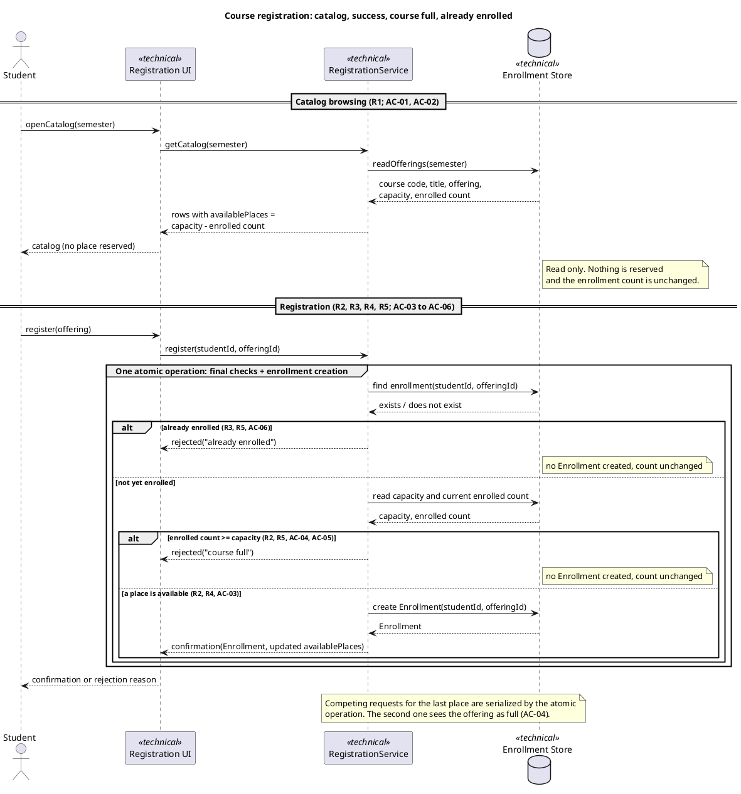
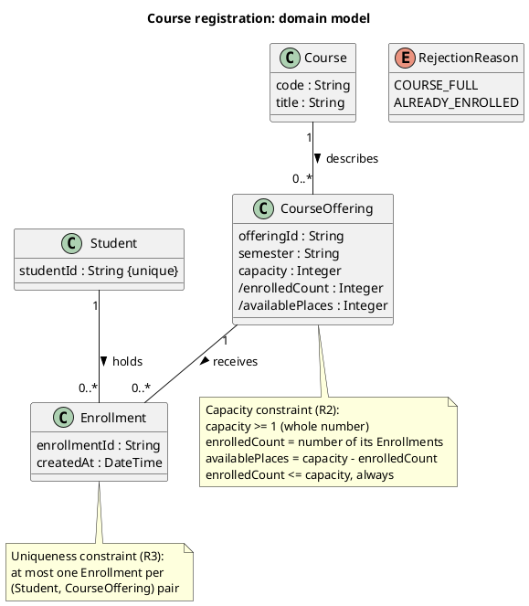
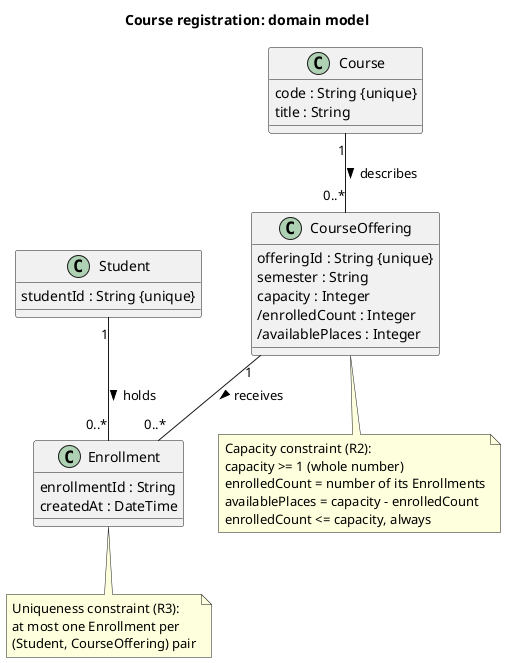

# SIS #02 — AI-Assisted UML Modeling: University Course Registration

<!--
  This is the only file you write your report in. README.md tells you what goes where.

  Rules the checker relies on:
  - Do not delete, rename or renumber the ## headings, the ### headings, or the **Label:** words.
  - Replace every "(write here)" and "(paste here)". None may be left when you submit.
  - Comments like this one are ignored by the checker and the word counter. Delete them or leave them.
-->

## 1. Scope and assumptions

**Scope:** This model covers single-semester university course catalog browsing and atomic student registration into a specific course offering with live capacity and duplicate-enrollment checks (R1–R5), while explicitly excluding payments, prerequisites, timetable clashes, waiting lists, and cancellation.

**Assumptions:**

1. Every student using the system is already signed in and identified by a unique student account before browsing or registering.
2. Each course offering represents a specific scheduled section of a course in a single semester with a fixed positive integer capacity, and viewing the catalog does not lock or reserve a seat.
3. Duplicate enrollment checks, current capacity checks, and enrollment creation happen together as a single atomic operation during registration so competing requests cannot take the same last place.
4. When a repeat request occurs on an offering that is also full, checking duplicate status (`R3`) before capacity (`R2`) provides deterministic rejection feedback.

## 2. User stories and acceptance criteria

### US-01 — Browse offerings

**US-01:** As a signed-in student, I want to view the catalog of offerings for one semester showing course code, title, offering and available places, so that I can choose an offering to register for.

- **AC-01** (R1): Given a semester that has offerings, each with a capacity and some existing enrollments, When the student opens the catalog for that semester, Then each offering is listed with its course code, course title, offering identifier and available places (capacity minus current enrollments), and no place is reserved for the student by viewing.
- **AC-02** (R1, R2): Given an offering whose enrollments equal its capacity, When the student views the catalog for that semester, Then the offering is still listed with 0 available places and the enrollment count is unchanged by the view.

### US-02 — Register for an offering

**US-02:** As a signed-in student, I want to register for a specific offering and receive a confirmation, so that I know I hold a place in it.

- **AC-03** (R2, R3, R4): Given an offering with at least one available place and a student with no enrollment in it, When the student requests registration for that offering, Then the system rechecks availability and duplicates, creates exactly one Enrollment linking the student and the offering, reduces available places by one, and returns a confirmation.
- **AC-04** (R2, R4, R5): Given an offering with exactly one available place and two different students who each have no enrollment in it, When both submit registration requests at the same time, having both seen the place as available in the catalog, Then exactly one request succeeds with a confirmation and one Enrollment, the other is rejected as "course full", and enrollments never exceed capacity.

### US-03 — Receive a clear rejection

**US-03:** As a signed-in student, I want a clear reason when my registration is refused, so that I know whether the offering is full or I am already enrolled in it.

- **AC-05** (R2, R5): Given an offering with no available places and a student with no enrollment in it, When the student requests registration, Then the system rejects the request with the explanation "course full", creates no Enrollment, and leaves the enrollment count unchanged.
- **AC-06** (R3, R5): Given a student who already has an enrollment in the offering, When the student requests registration for the same offering again, Then the system rejects the request with the explanation "already enrolled", creates no additional Enrollment, and leaves the enrollment count unchanged.

## 3. Sequence diagram

<!-- The FINAL diagram, rendered. Change .png to .svg if that is what you exported. -->


**Participants:** `Student` (the signed-in student actor who browses the semester catalog and submits registration requests), `Registration UI` (`UI`, the boundary interface that presents the catalog and displays confirmations or rejection reasons), `RegistrationService` (`Svc`, the application service that coordinates catalog reads and enforces the atomic registration workflow), and `Enrollment Store` (`Store`, the persistence store that holds `Course`, `CourseOffering`, and `Enrollment` records).

**Atomic operation:** Inside `critical One atomic operation: final checks + enrollment creation`, the messages `Svc -> Store : findEnrollment(studentId, offeringId)` (duplicate check, R3), `Svc -> Store : readCapacityAndCount(offeringId)` (live capacity recheck, R2), `Svc -> Store : createEnrollment(studentId, offeringId)`, and `Store --> Svc : Enrollment, newEnrolledCount` (R4) form one atomic operation. Because `openCatalog(semester)` is a read-only query that reserves nothing, serializing the checks and creation inside `critical` prevents competing requests from taking the same last place.

**Where the Enrollment is created:** The `Enrollment` instance (matching the `Enrollment` class in Section 4) is created exclusively inside the `else a place is available (R2, R4, AC-03)` branch by the message `Svc -> Store : createEnrollment(studentId, offeringId)` and returned via `Store --> Svc : Enrollment, newEnrolledCount`, strictly after both `findEnrollment` and `readCapacityAndCount` pass and before `confirmation(Enrollment, availablePlaces = capacity - newEnrolledCount)` is sent.

**Technical lifelines:** `Registration UI`, `RegistrationService`, and `Enrollment Store` are marked `<<technical>>` in the sequence diagram (`models/sequence.puml`) and do not appear in the domain class diagram (`models/classes.puml`). This separation of concerns is intentional: the domain class diagram models persistent business concepts and their structural relationships (`Student`, `Course`, `CourseOffering`, `Enrollment`), whereas the sequence diagram models runtime message passing across UI boundary, service coordination, and persistence layers.

## 4. Class diagram

<!-- The FINAL diagram, rendered. -->


<!-- One row per association in classes.puml, read in both directions. -->

| Association | Read left to right | Read right to left |
| --- | --- | --- |
| `Course "1" -- "0..*" CourseOffering : describes >` | One `Course` describes zero or more scheduled `CourseOffering` sections across semesters. | Each `CourseOffering` is a scheduled section of and is described by exactly one `Course`. |
| `Student "1" -- "0..*" Enrollment : holds >` | One `Student` holds zero or more `Enrollment` records across course offerings. | Each `Enrollment` record is held by and belongs to exactly one `Student`. |
| `CourseOffering "1" -- "0..*" Enrollment : receives >` | One `CourseOffering` receives zero or more `Enrollment` records from enrolled students. | Each `Enrollment` record targets and is received by exactly one `CourseOffering`. |

**How an Enrollment links a student to an offering:** `Enrollment` reifies the registration relationship between `Student` and `CourseOffering` with multiplicity `"1"` at the `Student` end (`Student "1" -- "0..*" Enrollment : holds >`) and `"1"` at the `CourseOffering` end (`CourseOffering "1" -- "0..*" Enrollment : receives >`), so each `Enrollment` instance connects exactly one `Student` and one `CourseOffering` with its own `enrollmentId` and `createdAt` timestamp.

**Capacity constraint:** Stated in the `note bottom of CourseOffering` (`Capacity constraint (R2)`): `capacity >= 1` (whole number), `/enrolledCount = number of its Enrollments`, `/availablePlaces = capacity - enrolledCount`, and `enrolledCount <= capacity, always`. UML multiplicity (`0..*` on `CourseOffering "1" -- "0..*" Enrollment`) cannot express this rule alone because the upper bound is a per-instance attribute (`CourseOffering.capacity`) rather than a fixed static integer.

**Uniqueness constraint:** Stated in the `note bottom of Enrollment` (`Uniqueness constraint (R3)`): `at most one Enrollment per (Student, CourseOffering) pair`. Multiplicity `0..*` on each binary association independently allows a `Student` to hold multiple enrollments and a `CourseOffering` to receive multiple enrollments, so an explicit constraint note is required to forbid two `Enrollment` instances from linking the exact same `(Student, CourseOffering)` pair.

## 5. Traceability

| Rule and criterion | Model evidence | Validation case |
| --- | --- | --- |
| R1 + AC-01, AC-02 | Sequence: `openCatalog(semester)`, `getCatalog(semester)`, `readOfferings(semester)`, and `rows with availablePlaces = capacity - enrolled count` with read-only note; Class: `Course` (`code`, `title`) and `CourseOffering` (`offeringId`, `semester`, `capacity`, `/enrolledCount`, `/availablePlaces`) | Catalog browsing check (pre-step of T1 and T3 verifying catalog fields and non-reservation note) |
| R2 + AC-02, AC-03, AC-04, AC-05 | Sequence: `readCapacityAndCount(offeringId)` inside `critical One atomic operation`, guards `alt enrolled count >= capacity (R2, R5, AC-04, AC-05)` and `else a place is available (R2, R4, AC-03)`; Class: `CourseOffering` (`capacity`, `/enrolledCount`, `/availablePlaces`) and `Capacity constraint (R2)` note (`enrolledCount <= capacity, always`) | T1, T2, T3 |
| R3 + AC-03, AC-04, AC-06 | Sequence: `findEnrollment(studentId, offeringId)` inside `critical One atomic operation`, guard `alt already enrolled (R3, R5, AC-06)` and `else not yet enrolled`; Class: `Student "1" -- "0..*" Enrollment`, `CourseOffering "1" -- "0..*" Enrollment`, and `Uniqueness constraint (R3)` note (`at most one Enrollment per (Student, CourseOffering) pair`) | T1, T2, T4 |
| R4 + AC-03, AC-04 | Sequence: guard `else a place is available (R2, R4, AC-03)`, `createEnrollment(studentId, offeringId)`, `Store --> Svc : Enrollment, newEnrolledCount`, and `confirmation(Enrollment, availablePlaces = capacity - newEnrolledCount)`; Class: `Enrollment` (`enrollmentId`, `createdAt`) linking `1` `Student` and `1` `CourseOffering` | T1, T2 |
| R5 + AC-04, AC-05, AC-06 | Sequence: `alt already enrolled` returning `rejected("already enrolled")` and `alt enrolled count >= capacity` returning `rejected("course full")` with notes `no Enrollment created, count unchanged` | T3, T4 |

## 6. Walkthroughs

<!-- Walk each case through YOUR final sequence diagram, message by message. Column 2: the
     actual steps and the state change (count before → after). Column 3 starts with Pass or
     Fail, then the location: the message, guard or note where you saw it. A Fail you
     report honestly is a finding, not a penalty. -->

| Case | Observed path and state change | Judgment and evidence |
| --- | --- | --- |
| T1. Available | `Student` calls `openCatalog(semester)` (`UI -> Svc : getCatalog`, `Svc -> Store : readOfferings`) and sees `capacity = 2`, `enrolled count = 0`, `availablePlaces = 2` with no seat reserved, then calls `register(offering)` (`UI -> Svc : register(studentId, offeringId)`). Inside `critical One atomic operation`, `findEnrollment` returns `does not exist` (`else not yet enrolled`), `readCapacityAndCount` returns `capacity = 2, enrolled count = 0`, execution enters `else a place is available (R2, R4, AC-03)`, calls `createEnrollment(studentId, offeringId)`, receives `Enrollment, newEnrolledCount = 1`, and returns `confirmation(Enrollment, availablePlaces = 1)`. | Pass — verified at guard `else a place is available (R2, R4, AC-03)` and messages `createEnrollment(studentId, offeringId)` and `confirmation`. |
| T2. Last place | With `capacity = 2` and `enrolled count = 1` (`1` place left), a new `Student` sends `register(offering)` (`UI -> Svc : register(studentId, offeringId)`). Inside `critical One atomic operation: final checks + enrollment creation`, `findEnrollment` returns `does not exist`, `readCapacityAndCount(offeringId)` returns `capacity = 2, enrolled count = 1`, and because `1 < 2`, execution enters `else a place is available`, calls `createEnrollment(studentId, offeringId)`, updates `newEnrolledCount = 2` (`availablePlaces = 2 - 2 = 0`, no places remain), and returns `confirmation`. | Pass — verified at `critical One atomic operation`, guard `else a place is available`, and reply `Store --> Svc : Enrollment, newEnrolledCount`. |
| T3. Full | `Student` earlier viewed `1` available place via `openCatalog(semester)` (`note right of Store : Read only. Nothing is reserved`), and another request took the last seat so `enrolled count = 2` (`capacity = 2`). When `Student` calls `register(offering)`, `findEnrollment` returns `does not exist`, `readCapacityAndCount(offeringId)` re-reads live `capacity = 2, enrolled count = 2`, and execution enters `alt enrolled count >= capacity (R2, R5, AC-04, AC-05)`, returning `rejected("course full")` with no `Enrollment` created and `enrolled count` unchanged at `2`. | Pass — verified at guard `alt enrolled count >= capacity (R2, R5, AC-04, AC-05)` and message `rejected("course full")`. |
| T4. Duplicate | With `capacity = 2` and `enrolled count = 1` where the same `Student` is already enrolled in that offering, `Student` sends `register(offering)` (`UI -> Svc : register(studentId, offeringId)`) a second time. Inside `critical One atomic operation`, `Svc -> Store : findEnrollment(studentId, offeringId)` returns `exists`, so execution immediately takes `alt already enrolled (R3, R5, AC-06)` and returns `rejected("already enrolled")` with no second `Enrollment` created and `enrolled count` unchanged at `1`. | Pass — verified at guard `alt already enrolled (R3, R5, AC-06)` and message `rejected("already enrolled")`. |

## 7. Review decisions

| AI suggestion or model element | Decision | Reason | Rule |
| --- | --- | --- | --- |
| D1 (`sequence.puml` — `Svc --> UI : confirmation(Enrollment, updated availablePlaces)`): `Store` returned only `Enrollment` without the updated enrollment count, leaving the source of `updated availablePlaces` implicit | Accepted | Returning `Enrollment, newEnrolledCount` from `Store` and passing `availablePlaces = capacity - newEnrolledCount` in `confirmation` makes the R4 availability update traceable in the message flow. | R4 |
| D2 (`sequence.puml` — `group One atomic operation: ...`): used a generic PlantUML `group` box instead of UML's `critical` combined fragment operator for an atomic region, and used spaced prose message names (`find enrollment`, `read capacity and current enrolled count`) | Accepted | Replacing `group` with `critical One atomic operation: final checks + enrollment creation` and using camelCase (`findEnrollment`, `readCapacityAndCount`, `createEnrollment`) gives formal UML atomic region semantics for competing requests in T2 and T3. | R2, R3, R4 |
| D3 (`classes.puml` — `enum RejectionReason { COURSE_FULL, ALREADY_ENROLLED }`): orphaned enum not linked to any class, lacking a `' why:` justification comment (failing check CL6), and mismatched with `"already enrolled"` / `"course full"` strings | Accepted (deleted `enum RejectionReason`) | Deleting the unlinked `RejectionReason` enum keeps the class diagram strictly focused on the four required domain classes (`Student`, `Course`, `CourseOffering`, `Enrollment`) while preserving the exact `"already enrolled"` and `"course full"` strings required by R5 in `sequence.puml`. | R5 |
| Optional suggestion (`sequence.puml` — add a second actor `Student B` lifeline to draw the two-student race in AC-04) | Rejected | Adding a second student actor lifeline would duplicate the registration messages and clutter the main flow, whereas the `critical` atomic block, live capacity re-read (`readCapacityAndCount`), and serialization note already model T2 and T3 clearly. | R2, R5 |

## 8. Modeling explanation

<!-- 200–300 words. Your main design choices; how the class diagram and the sequence diagram
     complement each other; why an activity diagram could also help explain the workflow. -->

Our two UML diagrams divide the course registration specification into complementary structural and behavioral views across rules R1–R5. In `models/classes.puml`, the domain class diagram captures the four persistent domain entities: `Student` (`studentId {unique}`), `Course` (`code {unique}`, `title`), `CourseOffering` (`offeringId {unique}`, `semester`, `capacity`, `/enrolledCount`, `/availablePlaces`), and `Enrollment` (`enrollmentId`, `createdAt`). Separating `Course` (`1`) from `CourseOffering` (`0..*`) distinguishes a subject description from a scheduled semester section. Rather than connecting `Student` and `CourseOffering` with a direct many-to-many line, `Enrollment` reifies each registration as an explicit domain object linked to `1` `Student` and `1` `CourseOffering`. Because static association multiplicities (`0..*`) cannot reference an instance attribute (`CourseOffering.capacity`) or forbid two `Enrollment` records from pairing the same student and offering, two UML constraint notes state the R2 capacity invariant (`enrolledCount <= capacity, always`) and the R3 pair-uniqueness invariant (`at most one Enrollment per (Student, CourseOffering) pair`).

In `models/sequence.puml`, the sequence diagram traces the time-ordered interactions across `Student` and three `<<technical>>` lifelines (`Registration UI`, `RegistrationService`, and `Enrollment Store`). First, `openCatalog(semester)` reads offerings and computes `availablePlaces = capacity - enrolled count` as a read-only operation that reserves no place (R1). Second, `register(studentId, offeringId)` enters `critical One atomic operation: final checks + enrollment creation`, where `findEnrollment` checks R3 and `readCapacityAndCount` rechecks live R2 availability before branching. Only `else a place is available` invokes `createEnrollment(studentId, offeringId)` and returns `confirmation(Enrollment, availablePlaces = capacity - newEnrolledCount)` (R4), whereas the two rejection branches return `"already enrolled"` or `"course full"` without mutating state (R5). A UML state machine diagram for `CourseOffering` (`Open`, `Full`) would further complement both views by showing state transitions as seats fill.

## 9. Reflection

<!-- 150–200 words. Written by you, not by the assistant: where AI helped, one decision you
     made yourself, one remaining limitation. Specific beats flattering. -->

Working through the four-stage AI modeling workflow showed that while Claude Sonnet 5.5 generated a strong initial structure in Prompt B, independent critique in a fresh session (Prompt C) and manual verification were essential to catch subtle modeling defects. In `models/original/sequence.puml`, the assistant initially used a generic `group` frame instead of `critical`, wrote inconsistent space-separated message labels (`find enrollment`, `read capacity and current enrolled count`), and returned `updated availablePlaces` in `confirmation` without returning `newEnrolledCount` from `Enrollment Store` (Defect D1). In `models/original/classes.puml`, it also added an isolated `enum RejectionReason` that was neither connected to any class nor used in the sequence messages (Defect D3).

During Section 7 review, I made the explicit engineering decision to accept Fixes D1–D3—removing `RejectionReason`, marking `Course.code` and `CourseOffering.offeringId` as `{unique}`, switching `group` to `critical`, and returning `newEnrolledCount`—while rejecting the optional suggestions to add a `Semester` class or a second `Student B` lifeline. One remaining limitation is that our sequence diagram represents concurrency serialization declaratively through a `critical` combined fragment and note rather than modeling database lock acquisition, timeouts, or transaction rollback mechanics.

## 10. Appendix A — Before AI

**Scope:** The system models university course catalog browsing for one semester and student registration into a specific course offering with duplicate and capacity validation, excluding payments, prerequisites, timetable clashes, waiting lists, and cancellation.

**Initial assumptions:**

1. Every student using the system is already signed in and identified by a unique student account before browsing or registering.
2. Each course offering represents a specific section in a single semester with a fixed positive integer capacity, and viewing the catalog does not lock or reserve a seat.
3. Duplicate enrollment checks, current capacity checks, and enrollment creation happen together as a single atomic step during registration so concurrent requests cannot exceed capacity.

## 11. Appendix B — AI exchanges

<!-- Complete prompts and complete responses, as text — never screenshots. Paste each inside
     the ~~~~ block that follows its label: AI responses contain ``` PlantUML blocks, and
     ~~~~ keeps them from breaking this file. Prompts B and C: the prompt text first, then
     the material it refers to ("below", "these two") pasted under it, in the same block.
     You may add B5, B6 … after B4 if you ran more. -->

### B1 — Requirements (Prompt A)

- **Tool:** Claude
- **Model:** Claude Sonnet 5.5
- **Date:** 2026-10-18
- **Purpose:** draft 3 user stories and 6 acceptance criteria

**Prompt:**

~~~~text
Act as a requirements analyst. Use only this course registration scenario and rules R1–R5:
A student browses an electronic course catalog, chooses a course offering and requests registration. Each offering has a limited number of places. A Course describes a subject. A CourseOffering is one scheduled section in one semester. Registration always targets a specific offering. Assume that the student is signed in, the selected offering exists, and its capacity is a positive whole number. A catalog view does not reserve a place. Model the final checks and enrollment creation as one atomic operation, so competing requests cannot take the same last place. Out of scope: payments, prerequisites, timetable clashes, waiting lists, cancellation.
R1. Catalog: Show the course code, title, offering and available places for one semester.
R2. Capacity: Recheck current availability when registering. Enrollment must never exceed the offering's capacity.
R3. Duplicates: A student may have at most one enrollment in the same offering. Reject a repeat request.
R4. Success: Create exactly one Enrollment linking the student and offering, update availability and return a confirmation.
R5. Rejection: Explain "course full" or "already enrolled". Create no enrollment and leave the enrollment count unchanged.
My initial assumptions are:
1. Every student using the system is already signed in and identified by a unique student account before browsing or registering.
2. Each course offering represents a specific section in a single semester with a fixed positive integer capacity, and viewing the catalog does not lock or reserve a seat.
3. Duplicate enrollment checks, current capacity checks, and enrollment creation happen together as a single atomic step during registration so concurrent requests cannot exceed capacity.
Draft 3 user stories and 2 Given / When / Then acceptance criteria for each. Use IDs US-01 to US-03 and AC-01 to AC-06. Map each criterion to rule IDs.
Cover normal and rejection behavior. List uncertainty separately. Do not add excluded features or invent university policies.
~~~~

**Response:**

~~~~text
Requirements Draft: Course Registration
User Stories
US-01 (Browse catalog)

As a signed-in student, I want to view the catalog of offerings for one semester showing course code, title, offering and available places, so that I can choose an offering to register for.
US-02 (Register successfully)

As a signed-in student, I want to register for a specific offering and receive a confirmation, so that I know I hold a place in it.
US-03 (Understand rejection)

As a signed-in student, I want a clear reason when my registration is refused, so that I know whether the offering is full or I am already enrolled in it.
Acceptance Criteria
AC-01 (US-01, Normal): Catalog display
- Given a semester that has offerings, each with a capacity and some existing enrollments
- When the student opens the catalog for that semester
- Then each offering is listed with its course code, course title, offering identifier and available places (capacity minus current enrollments), and no place is reserved for the student by viewing.
- Rules: R1
AC-02 (US-01, Boundary): Fully taken offering in catalog
- Given an offering whose enrollments equal its capacity
- When the student views the catalog for that semester
- Then the offering is still listed with 0 available places and the enrollment count is unchanged by the view.
- Rules: R1, R2
AC-03 (US-02, Normal): Successful registration
- Given an offering with at least one available place and a student with no enrollment in it
- When the student requests registration for that offering
- Then the system rechecks availability and duplicates, creates exactly one Enrollment linking the student and the offering, reduces available places by one, and returns a confirmation.
- Rules: R2, R3, R4
AC-04 (US-02, Boundary): Last place taken by competing requests
- Given an offering with exactly one available place and two different students who each have no enrollment in it
- When both submit registration requests at the same time, having both seen the place as available in the catalog
- Then exactly one request succeeds with a confirmation and one Enrollment, the other is rejected as "course full", and enrollments never exceed capacity.
- Rules: R2, R4, R5
AC-05 (US-03, Rejection): Course full
- Given an offering with no available places and a student with no enrollment in it
- When the student requests registration
- Then the system rejects the request with the explanation "course full", creates no Enrollment, and leaves the enrollment count unchanged.
- Rules: R2, R5
AC-06 (US-03, Rejection): Already enrolled
- Given a student who already has an enrollment in the offering
- When the student requests registration for the same offering again
- Then the system rejects the request with the explanation "already enrolled", creates no additional Enrollment, and leaves the enrollment count unchanged.
- Rules: R3, R5
Rule Coverage
RuleCriteriaR1AC-01, AC-02R2AC-02, AC-03, AC-04, AC-05R3AC-03, AC-06R4AC-03, AC-04R5AC-04, AC-05, AC-06Uncertainties (not resolved here)
1. Both conditions true: The rules do not say which message to show when an offering is full and the student is already enrolled in it. Both are valid reasons, and the rules give no priority between them.
2. Display of "offering": R1 lists "offering" as a displayed item but does not say which attribute identifies it (for example section label or schedule). AC-01 therefore uses "offering identifier".
3. Catalog freshness: The scenario says a catalog view does not reserve a place, but not how current the displayed availability must be. AC-04 assumes it can be stale.
4. Confirmation content: R4 requires "a confirmation" without stating what it contains.
5. Rejection when a competing request wins: In AC-04 the loser receives "course full". This follows from R2 and R5 but is an inference, since the scenario does not describe the concurrent case explicitly.
6. Empty semester: The behavior when a semester has no offerings is unspecified, so no criterion covers it.
7. Failure handling: The behavior if the atomic operation fails for technical reasons is not defined and falls outside R5's two named reasons.
~~~~

### B2 — UML drafts (Prompt B)

- **Tool:** Claude
- **Model:** Claude Sonnet 5.5
- **Date:** 2026-10-18
- **Purpose:** draft the sequence and class diagrams

**Prompt:**

~~~~text
Using my approved scenario, R1–R5, stories and criteria below, return separate PlantUML code blocks for a sequence diagram and a domain class diagram.
Sequence: include catalog browsing and guarded success, full-course and duplicate outcomes. Model final checks and creation as one atomic operation.
Class: show domain concepts, useful attributes and multiplicities. State the capacity and uniqueness constraints. Explain assumptions and any technical lifelines.

Approved scenario and rules R1–R5:
A student browses an electronic course catalog, chooses a course offering and requests registration. Each offering has a limited number of places. A Course describes a subject. A CourseOffering is one scheduled section in one semester. Registration always targets a specific offering. Assume that the student is signed in, the selected offering exists, and its capacity is a positive whole number. A catalog view does not reserve a place. Model the final checks and enrollment creation as one atomic operation, so competing requests cannot take the same last place. Out of scope: payments, prerequisites, timetable clashes, waiting lists, cancellation.
R1. Catalog: Show the course code, title, offering and available places for one semester.
R2. Capacity: Recheck current availability when registering. Enrollment must never exceed the offering's capacity.
R3. Duplicates: A student may have at most one enrollment in the same offering. Reject a repeat request.
R4. Success: Create exactly one Enrollment linking the student and offering, update availability and return a confirmation.
R5. Rejection: Explain "course full" or "already enrolled". Create no enrollment and leave the enrollment count unchanged.

Approved user stories and acceptance criteria:
### US-01 — Browse offerings
**US-01:** As a signed-in student, I want to view the catalog of offerings for one semester showing course code, title, offering and available places, so that I can choose an offering to register for.
- **AC-01** (R1): Given a semester that has offerings, each with a capacity and some existing enrollments, When the student opens the catalog for that semester, Then each offering is listed with its course code, course title, offering identifier and available places (capacity minus current enrollments), and no place is reserved for the student by viewing.
- **AC-02** (R1, R2): Given an offering whose enrollments equal its capacity, When the student views the catalog for that semester, Then the offering is still listed with 0 available places and the enrollment count is unchanged by the view.

### US-02 — Register for an offering
**US-02:** As a signed-in student, I want to register for a specific offering and receive a confirmation, so that I know I hold a place in it.
- **AC-03** (R2, R3, R4): Given an offering with at least one available place and a student with no enrollment in it, When the student requests registration for that offering, Then the system rechecks availability and duplicates, creates exactly one Enrollment linking the student and the offering, reduces available places by one, and returns a confirmation.
- **AC-04** (R2, R4, R5): Given an offering with exactly one available place and two different students who each have no enrollment in it, When both submit registration requests at the same time, having both seen the place as available in the catalog, Then exactly one request succeeds with a confirmation and one Enrollment, the other is rejected as "course full", and enrollments never exceed capacity.

### US-03 — Receive a clear rejection
**US-03:** As a signed-in student, I want a clear reason when my registration is refused, so that I know whether the offering is full or I am already enrolled in it.
- **AC-05** (R2, R5): Given an offering with no available places and a student with no enrollment in it, When the student requests registration, Then the system rejects the request with the explanation "course full", creates no Enrollment, and leaves the enrollment count unchanged.
- **AC-06** (R3, R5): Given a student who already has an enrollment in the offering, When the student requests registration for the same offering again, Then the system rejects the request with the explanation "already enrolled", creates no additional Enrollment, and leaves the enrollment count unchanged.
~~~~

**Response:**

~~~~text
Sequence diagram

Domain class diagram

Assumptions and notes
Technical lifelines. These are not domain concepts and are marked <<technical>>:
- Registration UI is the screen the student interacts with.
- RegistrationService coordinates catalog reads and registration. It is a placeholder for whatever component runs the use case.
- Enrollment Store is the shared data holder. It stands for whatever guarantees atomicity. The scenario does not name a mechanism, so the diagram does not pick one (locking, transactions and so on).
Sequence assumptions.
- The student is signed in and the offering exists, so there is no authentication or "offering not found" path.
- The atomic group covers both final checks and the creation. The rejection branches end inside the group with no write, which shows R5 (no Enrollment, count unchanged).
- The order of checks (duplicate first, then capacity) is a modeling choice. R2, R3 and R5 give no priority, so it matters only when both conditions are true. This is the first item in my earlier uncertainty list and remains open.
- The "second request sees the offering as full" outcome in AC-04 is an inference from R2 and R5, as noted before.
Class assumptions.
- /enrolledCount and /availablePlaces are derived (the / prefix). They are computed from Enrollments rather than stored independently, which supports "update availability" in R4 without a separate counter.
- Student.studentId stands for the unique student account in your first assumption. No other student attributes are added.
- semester is an attribute of CourseOffering, not a separate class. This follows "one scheduled section in one semester". offeringId is a placeholder for whatever identifies an offering in R1, which is still an open uncertainty.
- createdAt and enrollmentId are minimal useful attributes, not requirements from R1–R5.
- RejectionReason is a value set for the two R5 reasons. The confirmation (R4) is not modeled as a class because its content is unspecified. It appears only as a message in the sequence diagram.
- The multiplicities allow a CourseOffering to have zero Enrollments. The upper bound on Enrollments per offering is the capacity constraint, which a multiplicity cannot express, so it is written in the note.
~~~~

### B3 — Model critique (Prompt C)

- **Tool:** Claude
- **Model:** Claude Sonnet 5.5
- **Date:** 2026-10-18
- **Purpose:** review both models against R1–R5 and T1–T4

**Prompt:**

~~~~text
Review these two UML models against R1–R5 and my acceptance criteria. Check message order, guards, state changes, multiplicities and naming.
Inspect the four validation cases: available places, exactly one place, full course after a stale catalog view, and duplicate registration.
For each issue, cite the affected rule and model element. Explain the impact and propose a focused correction. Separate genuine defects from optional design choices.

Scenario and rules R1–R5:
A student browses an electronic course catalog, chooses a course offering and requests registration. Each offering has a limited number of places. A Course describes a subject. A CourseOffering is one scheduled section in one semester. Registration always targets a specific offering. Assume that the student is signed in, the selected offering exists, and its capacity is a positive whole number. A catalog view does not reserve a place. Model the final checks and enrollment creation as one atomic operation, so competing requests cannot take the same last place. Out of scope: payments, prerequisites, timetable clashes, waiting lists, cancellation.
R1. Catalog: Show the course code, title, offering and available places for one semester.
R2. Capacity: Recheck current availability when registering. Enrollment must never exceed the offering's capacity.
R3. Duplicates: A student may have at most one enrollment in the same offering. Reject a repeat request.
R4. Success: Create exactly one Enrollment linking the student and offering, update availability and return a confirmation.
R5. Rejection: Explain "course full" or "already enrolled". Create no enrollment and leave the enrollment count unchanged.

Approved Acceptance Criteria:
- AC-01 (R1): Given a semester that has offerings, each with a capacity and some existing enrollments, When the student opens the catalog for that semester, Then each offering is listed with its course code, course title, offering identifier and available places (capacity minus current enrollments), and no place is reserved for the student by viewing.
- AC-02 (R1, R2): Given an offering whose enrollments equal its capacity, When the student views the catalog for that semester, Then the offering is still listed with 0 available places and the enrollment count is unchanged by the view.
- AC-03 (R2, R3, R4): Given an offering with at least one available place and a student with no enrollment in it, When the student requests registration for that offering, Then the system rechecks availability and duplicates, creates exactly one Enrollment linking the student and the offering, reduces available places by one, and returns a confirmation.
- AC-04 (R2, R4, R5): Given an offering with exactly one available place and two different students who each have no enrollment in it, When both submit registration requests at the same time, having both seen the place as available in the catalog, Then exactly one request succeeds with a confirmation and one Enrollment, the other is rejected as "course full", and enrollments never exceed capacity.
- AC-05 (R2, R5): Given an offering with no available places and a student with no enrollment in it, When the student requests registration, Then the system rejects the request with the explanation "course full", creates no Enrollment, and leaves the enrollment count unchanged.
- AC-06 (R3, R5): Given a student who already has an enrollment in the offering, When the student requests registration for the same offering again, Then the system rejects the request with the explanation "already enrolled", creates no additional Enrollment, and leaves the enrollment count unchanged.

Model 1 — Sequence Diagram (`models/original/sequence.puml`):


Model 2 — Class Diagram (`models/original/classes.puml`):

~~~~

**Response:**

~~~~text
Review of the sequence and class models against R1-R5
Overall: both models satisfy all four validation cases and the message order is sound. I found three small genuine defects, all easy to fix. The rest of my findings are optional design choices.
Validation cases
CaseTrace in the sequence diagramResultAvailable places (AC-03, R2/R3/R4)find enrollment → none → read capacity and count → count < capacity → create Enrollment → confirmationPass, except the availability source gap in D1Exactly one place (AC-04, R2/R4)Winner: count = capacity − 1, so create succeeds. Loser: runs after the winner commits, reads count = capacity, and gets "course full".Pass, but only the single-student flow is drawn. The race is covered by the closing note.Full course after stale catalog view (AC-04/AC-05, R2/R5)register(studentId, offeringId) carries no availability value, and the service re-reads capacity and count from the store, so a stale catalog cannot influence the result.PassDuplicate registration (AC-06, R3/R5)find enrollment → exists → rejected("already enrolled"), with no createPassGenuine defects
D1. Updated availability in the confirmation has no source (R4, AC-03).
- Element: the message Svc --> UI : confirmation(Enrollment, updated availablePlaces).
- Problem: the store returns only the Enrollment, and the service never receives or computes an updated count. R4 requires availability to be updated and a confirmation returned, so the diagram cannot show where the updated value comes from.
- Impact: low-to-moderate. It is a traceability gap in the message flow, not a logic error, because /availablePlaces is derived in the class diagram.
- Fix: either return the new count from the store (Store --> Svc : Enrollment, new enrolled count) or have the service compute it from the count it already read. Then write confirmation(Enrollment, capacity - new enrolled count).
D2. Atomicity is drawn with a non-UML group (R2, AC-04).
- Element: group One atomic operation: ....
- Problem: the brief requires the final checks and creation to be modelled as one atomic operation. A PlantUML group is only a labelled box with no UML semantics. UML's operator for an atomic region is critical.
- Impact: moderate for rigor. The intent is clear from the label, but the key concurrency requirement rests on a caption.
- Fix: replace group with critical One atomic operation: final checks + enrollment creation, keeping the same end.
D3. RejectionReason is orphaned and its names do not match the sequence diagram (R5).
- Elements: enum RejectionReason {COURSE_FULL, ALREADY_ENROLLED} versus rejected("already enrolled") and rejected("course full").
- Problem: the enum is not linked to any class and the sequence uses free-text strings instead of its literals.
- Impact: low. The two models cannot be traced to each other, and the wording could drift.
- Fix: write rejected(ALREADY_ENROLLED) and rejected(COURSE_FULL) in the sequence diagram, and add a note that the UI shows the explanation text "already enrolled" or "course full". Alternatively, delete the enum if the string messages are intended.
Optional design choices (not defects)
- Check order: duplicates are checked before capacity. A student already enrolled in a full offering therefore gets "already enrolled", which is the more accurate message, and R5 permits it. I'd record it as an explicit decision, because AC-05 and AC-06 never specify the combined case.
- Returns inside the atomic region: the Svc --> UI replies sit inside the group, so the region visually extends past the store operations. Moving them out would need the outcome stored in a variable and is not worth the clutter.
- Two-student race: adding a second actor (Student B) with its own catalog view would make AC-04 visible. The current note, the id-only register call and the re-read already cover it.
- AC-02: the catalog flow has no filter, so full offerings are implicitly listed with 0 places. A short note such as "includes offerings with 0 available places" would make this explicit.
- Uniqueness: only Student.studentId is marked {unique}. offeringId and Course.code could be marked the same way for consistency. The R3 pair uniqueness is adequately stated in the note, though {unique} on the Enrollment's two ends would be tighter.
- Message naming: find enrollment(...) and read capacity and current enrolled count are prose, while other messages are camelCase operations such as readOfferings. For consistency, use findEnrollment(studentId, offeringId) and readCapacityAndCount(offeringId).
- Semester: it is a String attribute on CourseOffering, which is enough for R1. A Semester class is unnecessary here.
What checked out
- Multiplicities: Course 1—0..* CourseOffering, Student 1—0..* Enrollment and CourseOffering 1—0..* Enrollment are correct. Each Enrollment has exactly one student and one offering.
- Class diagram invariants: capacity >= 1, enrolledCount <= capacity and availablePlaces = capacity - enrolledCount match R2 and AC-01.
- Guards: the alt branches are complementary and complete, with R/AC references on each.
- State changes: rejection branches create nothing and leave the count unchanged (R5, AC-05, AC-06), and the catalog is read-only (AC-01, AC-02).
- Scope: nothing from the out-of-scope list (payments, prerequisites, timetables, waiting lists, cancellation) has crept in.
~~~~

### B4 — Focused revision (Prompt D)

- **Tool:** Claude
- **Model:** Claude Sonnet 5.5
- **Date:** 2026-10-18
- **Purpose:** apply my accepted review decisions

**Prompt:**

~~~~text
Revise the UML sources using only my accepted review decisions:
1. Accept Defect D1 (R2, R4, AC-03): In `sequence.puml`, change the store reply after `createEnrollment` to `Store --> Svc : Enrollment, newEnrolledCount` and update the confirmation message to `Svc --> UI : confirmation(Enrollment, availablePlaces = capacity - newEnrolledCount)` so the updated availability is explicitly traced.
2. Accept Defect D2 and message naming consistency (R2, R3, R4, AC-04): In `sequence.puml`, replace `group One atomic operation: final checks + enrollment creation` with `critical One atomic operation: final checks + enrollment creation`, and use consistent camelCase message names with parameters: `findEnrollment(studentId, offeringId)`, `readCapacityAndCount(offeringId)`, and `createEnrollment(studentId, offeringId)`. Keep the unbracketed `alt` / `else` guards and rejection notes unchanged.
3. Accept Defect D3 and identifier uniqueness (R1, R3, R5): In `classes.puml`, delete `enum RejectionReason` so only the four required domain classes (`Student`, `Course`, `CourseOffering`, `Enrollment`) remain, and mark `Course.code` and `CourseOffering.offeringId` with `{unique}`.
4. Reject Optional Suggestions on `Semester` class and second `Student B` lifeline: Keep `semester : String` on `CourseOffering` and keep the single `Student` lifeline with the serialization note.
Keep justified existing elements and explain each change.
Preserve the agreed scope and rule IDs. Return both updated PlantUML blocks and a concise change log. Flag any unresolved issue.
Approved requirements:
US-01 (Browse offerings):
- AC-01 (R1): Given a semester that has offerings, each with a capacity and some existing enrollments, When the student opens the catalog for that semester, Then each offering is listed with its course code, course title, offering identifier and available places (capacity minus current enrollments), and no place is reserved for the student by viewing.
- AC-02 (R1, R2): Given an offering whose enrollments equal its capacity, When the student views the catalog for that semester, Then the offering is still listed with 0 available places and the enrollment count is unchanged by the view.
US-02 (Register for an offering):
- AC-03 (R2, R3, R4): Given an offering with at least one available place and a student with no enrollment in it, When the student requests registration for that offering, Then the system rechecks availability and duplicates inside one atomic operation, creates exactly one Enrollment linking the student and offering, updates available places (capacity - newEnrolledCount), and returns a confirmation.
- AC-04 (R2, R3, R4, R5): Given an offering with 1 available place and two students (neither enrolled in it) who both saw 1 available place in the catalog and request registration at the same time, When both requests are processed atomically one after the other, Then the first request creates one Enrollment, reduces available places to 0 and returns a confirmation, and the second request rechecks availability, sees 0 available places, creates no Enrollment, leaves the enrollment count at capacity and is rejected with "course full".
US-03 (Receive a clear rejection):
- AC-05 (R2, R5): Given a student who is not enrolled in an offering whose enrollments already equal its capacity (including when the student's earlier catalog view still showed a free place), When the student requests registration for that offering, Then the system rechecks current availability, rejects the request with the reason "course full", creates no Enrollment, and leaves the enrollment count unchanged.
- AC-06 (R3, R5): Given a student who already has an Enrollment in an offering, When the student requests registration for that same offering again, Then the system detects the existing enrollment, rejects the request with the reason "already enrolled", creates no second Enrollment, and leaves the enrollment count unchanged.
Original sources:

models/original/classes.puml (revised)

Change log
1. sequence: Store --> Svc : Enrollment became Enrollment, newEnrolledCount (D1. The updated count now has an explicit source for R4, AC-03).
2. sequence: The confirmation became confirmation(Enrollment, availablePlaces = capacity - newEnrolledCount) (D1. capacity comes from the earlier readCapacityAndCount reply inside the same atomic region).
3. sequence: group became critical, with the same title and the same closing end (D2. Atomicity is now expressed with a UML-aligned operator for R2, AC-04).
4. sequence: find enrollment(...), read capacity and current enrolled count and create Enrollment(...) became findEnrollment(studentId, offeringId), readCapacityAndCount(offeringId) and createEnrollment(studentId, offeringId) (Naming consistency for R2, R3, R4).
5. classes: Deleted enum RejectionReason (D3 alternative. Only the four domain classes remain, and the sequence keeps rejected("already enrolled") and rejected("course full") for R5).
6. classes: Course.code and CourseOffering.offeringId are now marked {unique} (Identifier consistency with Student.studentId).
Kept unchanged, with reasons:
- The catalog section, the alt guards and the R/AC tags are unchanged because they are correct.
- Multiplicities and the invariants note are unchanged, as is the R3 pair-uniqueness note.
- The closing serialization note stays because it covers the race in AC-04.
- semester : String stays, as you rejected the Semester class, and no Student B lifeline was added.
Unresolved issues and flags
- Not rendered: I haven't rendered either block in PlantUML, so please run a render to confirm that critical ... end and the multi-line confirmation label display as expected.
- "T1 and T2": your evidence mentions T1 and T2, but they are not defined in the material you gave me, so I could not map the changes to them.
- Not accepted, so left as is: the duplicate-before-capacity check order in the combined case, the Svc --> UI replies drawn inside the atomic region, and an explicit note in the catalog section that full offerings appear with 0 places (AC-02).
- Free-text rejection reasons: with the enum removed, the two rejection strings exist only in the sequence diagram, so the class diagram no longer names them.
~~~~

## 12. Appendix C — Original diagrams

<!-- The AI's first output from Prompt B, rendered unedited from models/original/. -->


## 13. Appendix D — References and source checks

### References

- Sommerville, I. (2016). *Software Engineering* (10th ed., Global Edition). Pearson. Chapter 5: System Modeling, Section 5.2 (Context and Interaction Models, pp. 149–154) and Section 5.3 (Structural Models, pp. 154–160).
- PlantUML Language Reference Guide — Sequence Diagram Specification (`alt`/`else` groups, `critical` combined fragments, notes, and lifelines), https://plantuml.com/sequence-diagram (accessed 2026-10-18).
- PlantUML Language Reference Guide — Class Diagram Specification (associations, multiplicities, derived attributes, and constraint notes), https://plantuml.com/class-diagram (accessed 2026-10-18).

### Source checks

| Modeling decision | Source and locator | What the source says | How it supports or changed your model |
| --- | --- | --- | --- |
| Reifying `Enrollment` as an intermediate domain class with `"1"` to `"0..*"` associations to `Student` and `CourseOffering` plus separate constraint notes (`Capacity constraint (R2)`, `Uniqueness constraint (R3)`) | Sommerville (2016), *Software Engineering* 10th ed., Chapter 5, Section 5.3, pp. 154–159, and https://plantuml.com/class-diagram (accessed 2026-10-18) | Structural class models represent many-to-many domain relationships that carry attributes or rules as a dedicated link entity with explicit multiplicities at both ends, and domain invariants that cannot be expressed by multiplicity numbers alone are attached as UML notes. | Supported modeling `Enrollment` (`enrollmentId`, `createdAt`) with `"1"` to `"0..*"` multiplicities from `Student` and `CourseOffering`, removing the unconnected `RejectionReason` enum, and attaching the R2 capacity and R3 uniqueness invariants as UML notes in `models/classes.puml`. |
| Using the `critical` combined fragment for atomic registration checks and nested `alt` / `else` fragments for mutually exclusive duplicate, full-course, and success outcomes | Sommerville (2016), *Software Engineering* 10th ed., Chapter 5, Section 5.2, Figure 5.6, pp. 151–153, and https://plantuml.com/sequence-diagram (accessed 2026-10-18) | UML sequence diagrams use `critical` combined fragments to designate atomic regions that competing traces cannot interleave and `alt`/`else` combined fragments to model guarded mutually exclusive outcomes. | Supported replacing `group` with `critical One atomic operation: final checks + enrollment creation` in `models/sequence.puml` (Defect D2) and keeping unbracketed `alt already enrolled`, `alt enrolled count >= capacity`, and `else a place is available` guards. |